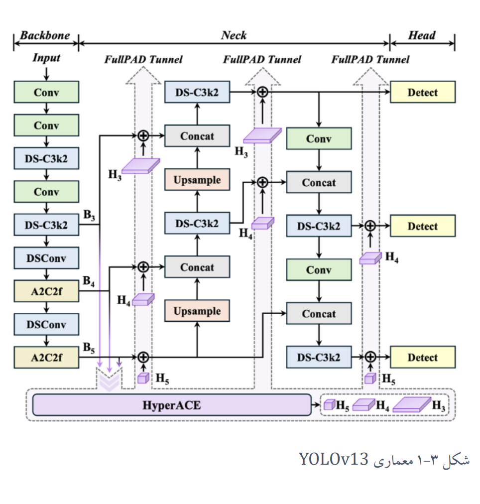
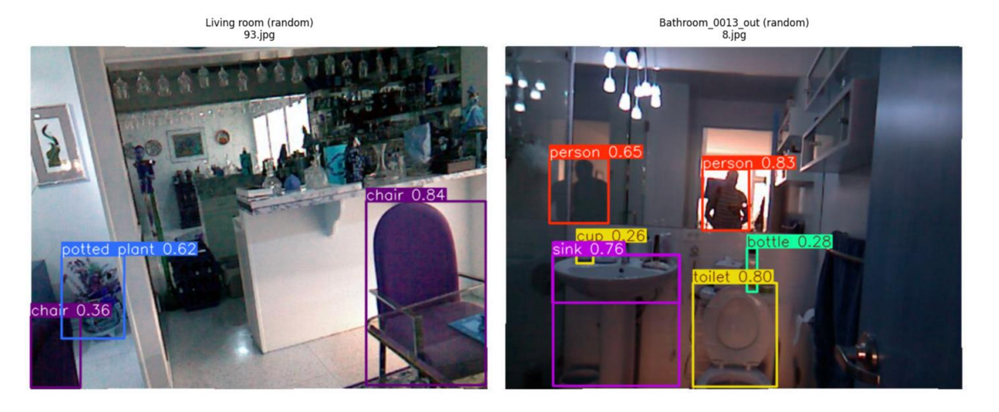
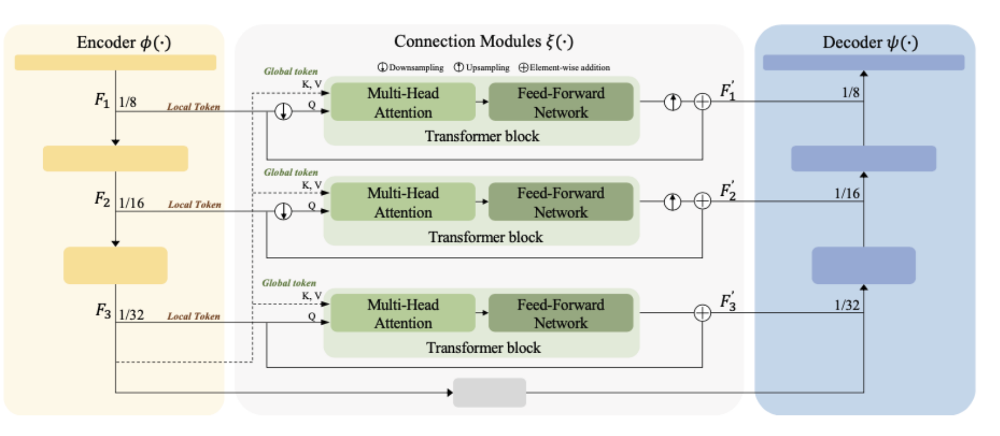
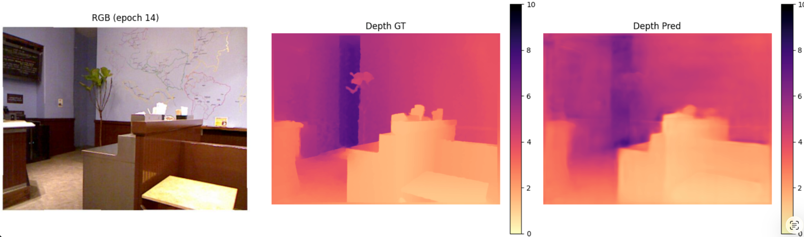
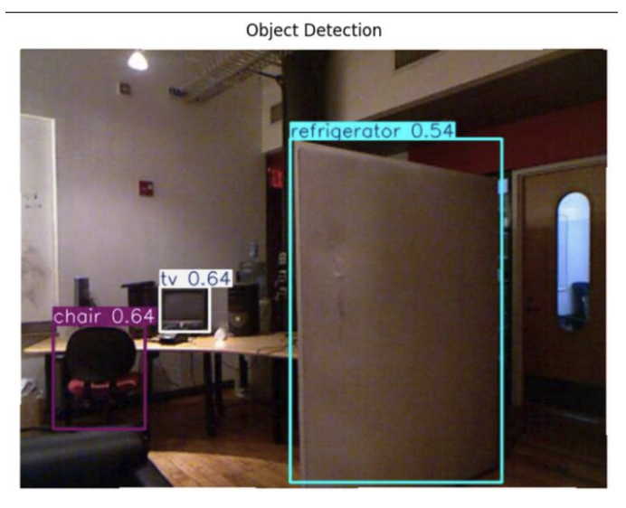
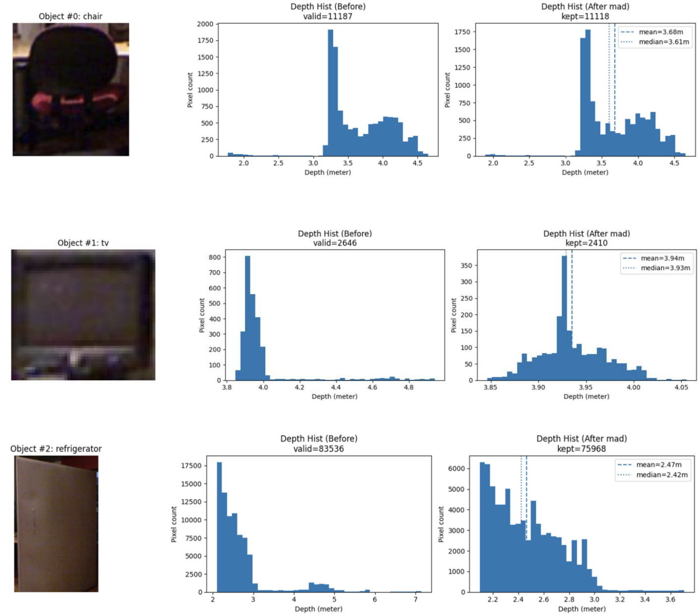

# bachelor_project
# Object Detection and Monocular Depth Estimation Using YOLOv13 and TST

This repository presents my bachelor's project on **object detection** and **monocular depth estimation** from a single RGB image. The project combines **YOLOv13** for object detection with a **Token-Sharing Transformer (TST)**-based depth estimation network in order to detect objects, estimate their distance, remove unreliable depth values, and report the final object distance in **meters**.

The final system is designed as an end-to-end pipeline:

1. **Input a single RGB image**
2. **Detect objects** using YOLOv13
3. **Predict a dense depth map** using TST
4. **Extract depth values inside each detected bounding box**
5. **Remove outlier depth values** using statistical filtering
6. **Estimate the final distance of each object in meters**

---

## Project Overview

Object detection answers **what the object is** and **where it is located**, while monocular depth estimation provides **how far the scene points are** from the camera. In many intelligent vision applications such as robotics, embedded systems, and autonomous navigation, these two tasks are both important.

In this project:

- **YOLOv13** is used to detect objects in the image.
- **TST (Token-Sharing Transformer)** is used to estimate scene depth from a single RGB image.
- The predicted depth inside each object's bounding box is analyzed.
- Outlier depth values are filtered to improve robustness.
- A final distance value is assigned to each detected object and displayed in the output image.

---

## 1. YOLOv13 Architecture

**Reference paper:** [Lei et al. (2025), *YOLOv13: Real-Time Object Detection with Hypergraph-Enhanced Adaptive Visual Perception*](https://arxiv.org/abs/2506.17733).

The object detection part of the project is based on **YOLOv13**. The architecture includes a **backbone**, **neck**, and **head**, and uses multi-scale detection for identifying objects at different spatial resolutions.



*Figure 1. YOLOv13 architecture used for object detection.*

This network is responsible for:

- extracting image features,
- combining them across scales,
- and predicting object classes, locations, and confidence scores.

---

## 2. YOLOv13 Detection Output

The figure below shows example object detection outputs from YOLOv13. The network predicts object classes together with confidence scores and bounding boxes.



*Figure 2. Example outputs of YOLOv13 object detection.*

As shown above, YOLOv13 can detect indoor objects such as **chair**, **person**, **sink**, **toilet**, **bottle**, and **potted plant** with their corresponding confidence values.

---

## 3. TST Depth Estimation Architecture

**Reference paper:** [Lee et al. (2023), *Lightweight Monocular Depth Estimation via Token-Sharing Transformer*](https://arxiv.org/abs/2306.05682).

For monocular depth estimation, this project uses a **TST-based architecture**. The model consists of:

- an **encoder** that extracts hierarchical features,
- **connection modules** based on token sharing and multi-head attention,
- and a **decoder** that reconstructs the final dense depth map.



*Figure 3. TST architecture used for monocular depth estimation.*

The TST model is designed to capture both:

- **local information** from different feature levels, and
- **global contextual information** through transformer-based token sharing.

This improves the model's ability to predict meaningful depth from only one RGB image.

---

## 4. Depth Prediction at Epoch 14

The following figure shows an example qualitative result from **epoch 14**, including:

- the input **RGB image**,
- the **ground-truth depth map**,
- and the **predicted depth map**.



*Figure 4. Qualitative depth estimation result at epoch 14: RGB image, depth ground truth, and predicted depth.*

This result shows that the trained TST model is able to recover the general depth structure of the scene and produce a meaningful dense depth prediction.

---

## 5. Final Integrated Project Output

After combining object detection and depth estimation, the final system produces a full output in which:

- objects are detected by **YOLOv13**,
- each object region is analyzed using the **predicted depth map**,
- outlier depth values are removed,
- and the final distance of each object is reported in **meters**.

### 5.1 Object Detection Result

The figure below shows the detected objects in one sample image.



*Figure 5. Final object detection result before detailed depth-distribution analysis.*

In this example, the detected objects include:

- **chair**
- **tv**
- **refrigerator**

Each object is first localized using a bounding box and confidence score.

### 5.2 Depth Distribution and Outlier Removal

The next figure shows the depth-distribution analysis for each detected object. For every object, the project compares the depth histogram **before** and **after** outlier removal.



*Figure 6. Per-object depth histograms before and after outlier removal, used to obtain a more robust distance estimate.*

This step is important because the raw depth values inside a bounding box may contain:

- background pixels,
- noisy values,
- or inaccurate predictions near object boundaries.

By removing outliers, the final estimated distance becomes more stable and more representative of the real object position.

---

## 6. Final Goal of the Project

The final goal of this project is to create a practical computer vision pipeline that can:

- detect objects from a single RGB image,
- estimate scene depth without a dedicated depth sensor,
- reduce unreliable depth measurements,
- and provide an estimated distance in meters for each detected object.

This type of pipeline can be useful in applications such as:

- robotics,
- indoor scene understanding,
- assistive systems,
- embedded AI,
- and intelligent navigation.

---

## 7. Training and Evaluation Summary

Based on the project poster, the training setup includes:

- **Optimizer:** Adam
- **Learning rate:** 0.0003
- **Epochs:** 14
- **Depth range:** 0–10 m
- **Loss function:** Scale-invariant logarithmic loss

Reported quantitative results on the poster are:

| Method | δ1 ↑ | AbsRel ↓ | SqRel ↓ | RMSE ↓ |
|---|---:|---:|---:|---:|
| TuMDE | 0.806 | 0.143 | 0.096 | 0.485 |
| FastDepth | 0.781 | 0.157 | 0.117 | 0.536 |
| GuidedDepth | 0.840 | 0.129 | 0.088 | 0.449 |
| GuidedDepth-S | 0.817 | 0.140 | 0.095 | 0.484 |
| **Our depth model** | **0.897** | **0.127** | **0.088** | **0.4368** |

These results indicate that the proposed depth model achieves competitive performance, especially in terms of **δ1**, **AbsRel**, and **RMSE**.

---

## 8. Repository Structure

```bash
bachelor_project/
├── README.md
├── analytics/
│   ├── nyu-depth.ipynb
│   ├── app_object&distance.ipynb
│   ├── epochs/
│   └── test images/
├── my_app/
│   ├── gui_app.py
│   ├── model_depth.py
│   ├── detect.py
│   ├── best_tst_depth.pth
│   ├── requirements.txt
│   └── ultralytics/
├── report/
│   ├── project_poster.pdf
│   └── report_project.pdf
└── docs/
    └── images/
```

---

## 9. How to Place the Figures in GitHub

To make the README display the figures correctly, create this folder in your repository:

```bash
docs/images/
```

Then save your images with the following names:

- `docs/images/yolov13-architecture.png`
- `docs/images/yolov13-output.png`
- `docs/images/tst-architecture.png`
- `docs/images/epoch14-depth-output.png`
- `docs/images/final-detection-output.png`
- `docs/images/final-histogram-output.png`

After that, GitHub will automatically show the images inside the README.

---

## 10. Installation and Usage

### Clone the repository

```bash
git clone https://github.com/Amir3m7/bachelor_project.git
cd bachelor_project
```

### Create a virtual environment

```bash
python -m venv .venv
source .venv/bin/activate
```

On Windows:

```bash
.venv\Scripts\activate
```

### Install dependencies

```bash
pip install --upgrade pip
pip install -r my_app/requirements.txt
```

### Run the application

```bash
cd my_app
python gui_app.py
```

---

## 11. Conclusion

This project demonstrates an integrated vision framework that combines **YOLOv13-based object detection** with **TST-based monocular depth estimation**. The system not only detects objects, but also estimates their distances in meters and improves robustness through depth outlier removal.

In summary, the project provides:

- object detection,
- monocular depth estimation,
- per-object distance estimation,
- outlier filtering,
- and qualitative as well as quantitative evaluation.

This makes it a useful and practical framework for depth-aware object understanding from a single RGB image.

---

## 12. References and Original Papers

The following research papers provide the architectural foundations for the two main components used in this project:

1. **Lei, M., et al. (2025).** *YOLOv13: Real-Time Object Detection with Hypergraph-Enhanced Adaptive Visual Perception.* arXiv:2506.17733.  
   **Paper:** https://arxiv.org/abs/2506.17733  
   **Used for:** YOLOv13 object detection architecture, including HyperACE and FullPAD for cross-scale feature aggregation.

2. **Lee, D.-J., et al. (2023).** *Lightweight Monocular Depth Estimation via Token-Sharing Transformer.* arXiv:2306.05682 (ICRA 2023).  
   **Paper:** https://arxiv.org/abs/2306.05682  
   **Used for:** The TST-based monocular depth estimation architecture, featuring global token sharing, attention-based connection modules, and a lightweight design.

These papers describe the original methods. The implementation, integration, training, and per-object outlier analysis documented in this repository form the scope of this bachelor's project.

---

## Author

**Amir Mahdi Eslami**  
Bachelor's Project  
Supervisor: **Dr. Safayani**
